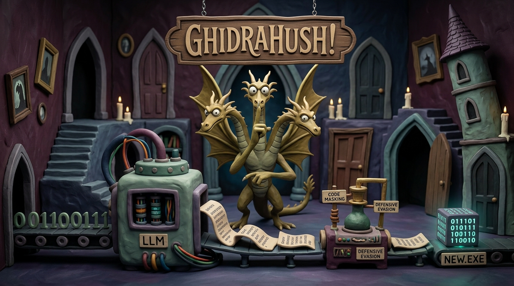
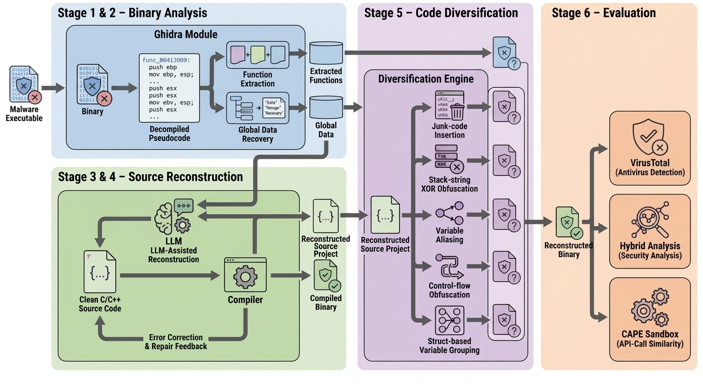

# GhidraHush



GhidraHush is a research framework for analyzing Windows binaries and turning Ghidra-decompiled functions into organized C/C++ source. It combines headless Ghidra analysis, an OpenAI-compatible LLM endpoint, MinGW cross-compilation, and optional sandbox/reporting integrations.

The pipeline is intended for **authorized reverse engineering, malware analysis, and controlled security research**. Decompilation and LLM-generated changes are not guaranteed to preserve behavior; review all output before using it. GhidraHush does not link the recovered functions into a replacement executable.

## Contents

- [Capabilities](#capabilities)
- [Requirements](#requirements)
- [Setup](#setup)
- [Configuration](#configuration)
- [Run the workflow](#run-the-workflow)
- [Stages](#stages)
- [Workspace and outputs](#workspace-and-outputs)
- [Evaluation and reports](#evaluation-and-reports)
- [Repository layout](#repository-layout)
- [Troubleshooting and limitations](#troubleshooting-and-limitations)
- [Security and responsible use](#security-and-responsible-use)
- [License](#license)

## Capabilities

- Imports and analyzes a target with Ghidra through PyGhidra, then exports decompiled functions and a call graph.
- Resolves some dynamically loaded API function-pointer types and applies selected compiler-helper adjustments before decompilation.
- Exports global data and recovered types to `data_globals.h` and `data_globals.c`.
- Sends extracted source through a configured LLM for cleanup and refactoring.
- Attempts compilation and source repair with MinGW, recording object files and per-function outcomes.
- Provides an optional stage for generating research variants from selected source transformations. This stage produces **source files**, not ready-to-run binaries; generated code requires independent review and validation.
- Can compare externally built candidate binaries with the original through a configured CAPE service and optionally query VirusTotal.

## Requirements

### Host

- Linux with Bash, Docker Engine, and the Docker Compose plugin.
- Network access from the app container to an OpenAI-compatible chat-completions endpoint (local or hosted).
- For evaluation: a reachable CAPE API. VirusTotal is optional.

### Container toolchain

The Docker image installs Python 3.11, OpenJDK 21, Ghidra 12.1.2, and 32-/64-bit MinGW compilers. Python dependencies are listed in [requirements.txt](requirements.txt). Compose bind-mounts the repository into the container, so source changes are visible without rebuilding the image.

The provided Compose file starts only the `app` container. It does **not** start Ollama or configure GPU passthrough. If using Ollama, run it separately and configure an endpoint reachable from the container. GPU use depends on the external model server and host setup.

## Setup

1. Clone the repository and change into its root directory.
2. Create a root-level `.env` file. Keep credentials private; `.env` is ignored by Git. At minimum, configure your LLM endpoint and model:

   ```dotenv
   LLM_BASE_URL=http://host.docker.internal:11434/v1
   LLM_MODEL=your-model-name
   LLM_API_KEY=your-provider-key
   ```

   The URL above is only an example for a separately running OpenAI-compatible service. Use the endpoint and authentication required by your provider. For providers that do not require a key, set a harmless placeholder if the client requires one.

3. Build the image:

   ```sh
   docker compose build
   ```

4. Confirm the configured endpoint is reachable from Docker. The Compose setup maps `host.docker.internal` to the host gateway on Linux; adjust `LLM_BASE_URL` if your model service is elsewhere.

No `docker compose up` service is needed for the interactive wrapper. It invokes a short-lived app container for each selected stage.

## Configuration

Set values in the root `.env` file unless otherwise noted. Do not commit real API keys.

| Variable | Purpose | Default / notes |
| --- | --- | --- |
| `LLM_BASE_URL` | OpenAI-compatible API base URL | Provider-specific; required for LLM stages. |
| `LLM_MODEL` | Model identifier sent to the API | `deepseek-coder-v2` if unset. |
| `LLM_API_KEY` | API authentication key | Depends on the endpoint. |
| `LLM_MAX_TOKENS` | Maximum generated tokens | `4096`. Increase only as supported by the provider/model. |
| `LLM_PACING_SECONDS` | Optional delay override | Current stage agents use the base agent's 40-second default, so this environment variable is not applied by the normal stage constructors. |
| `COMPILE_MAX_RETRIES` | Repair attempts for compilation failures | `3`. |
| `SDK_PROBE_COMPILER` | MinGW C compiler used for compilation and type probes | `i686-w64-mingw32-gcc`; the C++ compiler is derived from this name. |
| `AUTO_APPROVE` | Compiler repair approval behavior | `1` (enabled). |
| `STAGE3_QUARANTINE` | Quarantine likely stub functions before LLM processing | `1` (enabled). |
| `CAPE_API_URL` | CAPE API base URL | `http://host.docker.internal:8000/apiv2`. |
| `CAPE_API_TOKEN` | Optional CAPE authentication token | Empty by default. |
| `VT_API_KEY` | Enables VirusTotal lookups in evaluation | Unset disables VirusTotal. |

Custom Ghidra data-type archives can be placed in `gdt_archives/*.gdt`. Stage 1 loads archives found relative to the process working directory. The helper [generate_gdt.py](src/Auxiliary/generate_gdt.py) can build an archive from a C header.

## Run the workflow

Start the interactive wrapper from the repository root:

```sh
./GhidraHush.sh
```

Enter the path to an executable when prompted. The wrapper copies it into a newly allocated workspace named after the binary (for example, `workspace/sample/`, then `workspace/sample_1/` on a later launch). It then presents stages 1–6. Choose a stage, wait for that container run to finish, inspect or adjust its outputs as needed, then select the next stage from the menu.

**Each wrapper launch allocates a new workspace and resets the completion marker.** To continue work in an existing workspace, do not launch the wrapper again; invoke the entry point directly with that workspace and its copied executable:

```sh
docker compose run --rm app python3 ./src/entry.py \
  --stage 3 \
  --workspace workspace/sample \
  --exe workspace/sample/sample.exe
```

Replace the stage number, workspace, and executable path with the intended values. The entry point requires `--workspace` and `--exe`; `--stage` accepts 1 through 6 and defaults to 1. The wrapper's manual filtering step is important: inspect extracted functions and remove irrelevant runtime/library functions before running later stages. Preserve the workspace between stages.

## Stages



| Stage | Operation | Main result |
| --- | --- | --- |
| 1 | Analyze and decompile with Ghidra; build a reachable-function call graph. | `extracted_functions/<binary>/` |
| 2 | Recover global data and type information. | `data_globals.h`, `data_globals.c`, and symbol metadata in the workspace. |
| 3 | Clean/refactor extracted C/C++ using the configured LLM; likely stubs may be quarantined. | `processed_functions/`, updated headers, and quarantine metadata when applicable. |
| 4 | Resolve missing declarations, compile translation units, and attempt repairs. | `compiled_successfully/`, `failed_functions/`, `output_objects/`, and `llm_responses/`. |
| 5 | Optionally generate configured research source variants. | Variant source directories under `compiled_successfully/`; **not linked executables**. |
| 6 | Compare candidate executables with the original using CAPE and, optionally, VirusTotal. | Workspace evaluation folders and the shared Excel workbook. |

Stages are run individually; the tool does not automatically chain all six. Stage 4 compiles individual C/C++ translation units into object files and does not link them into an executable. Stage 5 can use Stage 4 sources when present, otherwise processed sources. Review and validate any generated changes in a controlled environment.

## Workspace and outputs

Each run is organized under `workspace/<binary-name>/` (with a numeric suffix if that directory already exists). Typical contents include:

| Path | Contents |
| --- | --- |
| `extracted_functions/<binary>/` | Decompiled function sources and call-graph data from Stage 1. |
| `ghidra_project/` | Shared Ghidra project for the run. |
| `data_globals.h`, `data_globals.c` | Global declarations and data emitted by Stage 2. |
| `processed_functions/` | LLM-processed source from Stage 3. |
| `compiled_successfully/` | Successfully processed source and generated variants. |
| `output_objects/` | Compiled object files; these are not a complete linked program. |
| `failed_functions/`, `llm_responses/` | Failed source and compiler-repair response artifacts. |
| `quarantined/` | Functions filtered as probable stubs, plus a manifest when created. |
| `executable_results/original/` | Copy of the original executable used for evaluation. |
| `executable_results/diversified_binaries/` | Candidate `.exe`, `.dll`, or `.sys` files discovered by Stage 6. |

Workspace artifacts may contain proprietary or sensitive decompiled code. Protect them accordingly.

## Evaluation and reports

Stage 6 searches recursively for `.exe`, `.dll`, and `.sys` candidates **only** under `executable_results/diversified_binaries/`. Place independently built and linked candidate binaries there before selecting Stage 6. The original is copied into `executable_results/original/` when the workspace is prepared.

CAPE comparisons and compilation/evaluation summaries are appended to `Results/comparisons.xlsx`. CAPE must be reachable at `CAPE_API_URL`; the configured service receives submitted samples. If `VT_API_KEY` is set, candidate files may be looked up or submitted to VirusTotal according to the scanner's behavior and account limits. VirusTotal is skipped when no key is configured. Check the policies of those services before sending samples.

Evaluation can also be run from the repository root if the listed Python dependencies are installed in the host environment:

```sh
python3 src/Auxiliary/run_evaluation.py \
  --workspace workspace/sample \
  --original workspace/sample/sample.exe
```

Use `--xlsx <path>` to choose a different workbook location.

## Repository layout

```text
GhidraHush/
├── docker-compose.yaml           # App container definition and bind mount
├── Dockerfile                    # Python, Java, Ghidra, MinGW, and dependencies
├── GhidraHush.sh                 # Interactive stage runner
├── requirements.txt
├── src/
│   ├── entry.py                  # Stage dispatch and workspace setup
│   ├── ghidra_scripts/           # Ghidra extraction and global-data export
│   ├── llm/                      # LLM clients, source processing, transformations
│   ├── compiler/                 # Compilation, ordering, and repair orchestration
│   ├── database/                 # Symbol/type support
│   ├── utils/                    # AST and global/API helpers
│   └── Auxiliary/                # Evaluation, reports, CAPE/VT, GDT helper
├── assets/                       # README and workflow diagrams
├── tests/                        # Sample fixtures organized by transformation
├── workspace/                    # Per-run generated artifacts (Git-ignored)
└── Results/                      # Shared reports
```

The `tests/` directory contains sample fixtures; the repository does not currently provide a conventional automated unit-test command.

## Troubleshooting and limitations

- **LLM connection/authentication errors:** Verify the OpenAI-compatible URL, model identifier, API key, and container-to-host/network connectivity. A service listening only on the host loopback may not be reachable from the container via `localhost`.
- **No extracted functions or poor pseudocode:** Results depend on the binary, symbols, Ghidra analysis, and entry-point discovery. Inspect the Ghidra project and extracted output; decompilation is inherently approximate.
- **Missing custom types:** Confirm `.gdt` files are under `gdt_archives/` in the working directory used for the stage.
- **Compiler failures:** Check that the translation unit and shared `data_globals.h` are present, inspect `failed_functions/` and `llm_responses/`, and confirm the configured MinGW toolchain is available in the image.
- **No candidates evaluated:** Stage 6 only scans `executable_results/diversified_binaries/`; source files and `.o` files are not candidates.
- **No CAPE results:** Confirm CAPE is running, reachable from the app container, and configured with the correct API URL/token.
- **Workspace confusion:** A new wrapper launch creates another workspace. Use the direct entry point with the exact existing workspace to continue.
- **PDBs:** The wrapper copies the executable, not a neighboring PDB. Do not assume a PDB will be available to Ghidra through this workflow.
- **GPU:** The Compose configuration has no GPU runtime configuration. GPU acceleration must be configured for the separately hosted model service, if applicable.

## Security and responsible use

Use GhidraHush only on binaries you are authorized to analyze. Treat LLM endpoints, CAPE, and VirusTotal as external data recipients unless you operate them yourself; do not transmit confidential samples or derived source without authorization. Malware samples and generated binaries should be handled in an isolated, controlled environment. LLM output can be incorrect, unsafe, or behavior-changing, and must not be considered a substitute for expert review.

## License

This project is distributed under the [MIT License](LICENSE).
